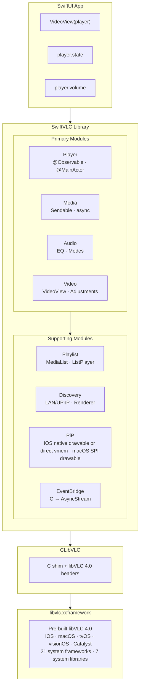
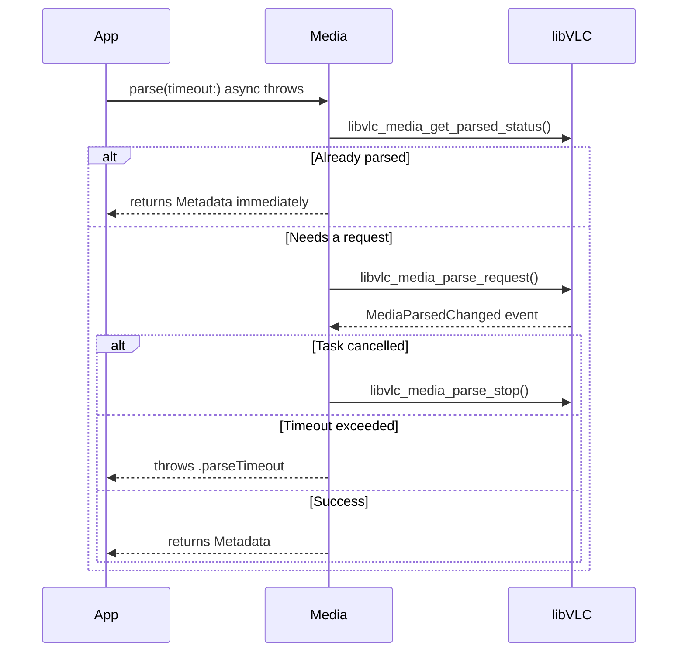
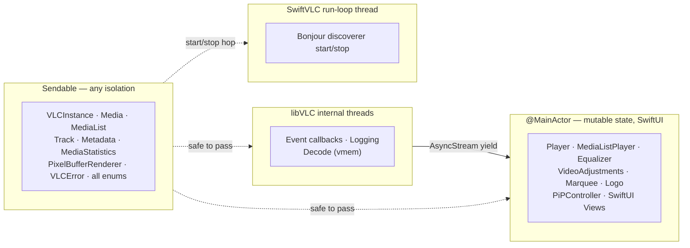
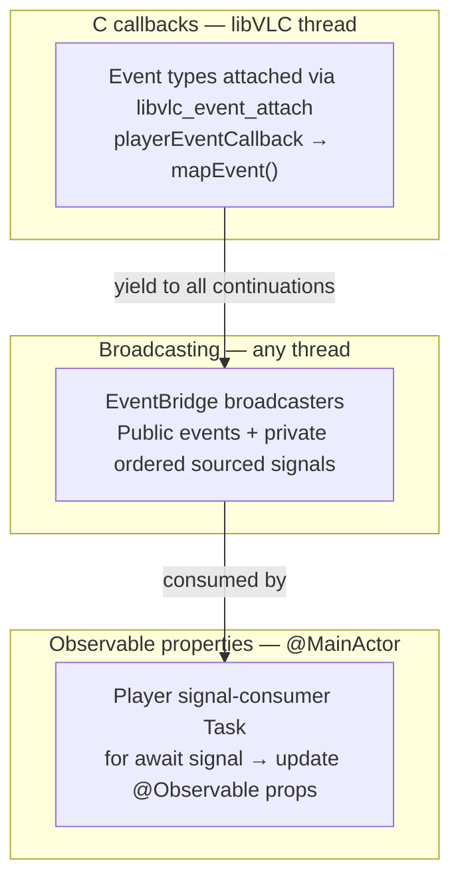
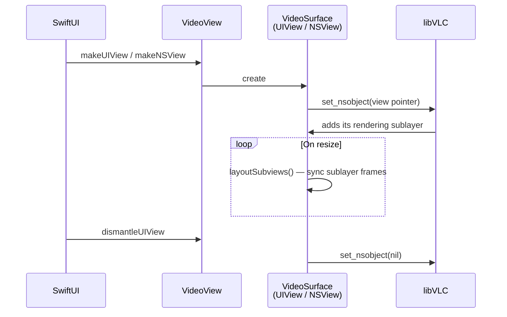
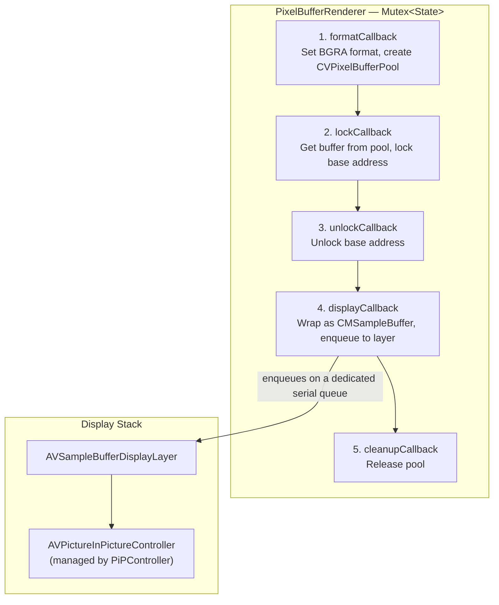

# Architecture

Technical decisions and design rationale for SwiftVLC, written for
contributors and reviewers.

> Looking for **how to use** SwiftVLC? See the DocC guides, published on
> [Swift Package Index](https://swiftpackageindex.com/harflabs/swiftvlc/documentation)
> or built locally with `swift package --disable-sandbox
> preview-documentation --target SwiftVLC`. This document covers the *why*:
> isolation choices, C-interop patterns, deinit ordering, rendering paths,
> the testing strategy, and the build/release machinery.

## Contents

- [High-Level Overview](#high-level-overview)
- [Tech Stack](#tech-stack)
- [Module Architecture](#module-architecture)
- [C Interop Layer](#c-interop-layer)
- [Concurrency & Threading Model](#concurrency--threading-model)
- [Event System](#event-system)
- [Memory Management](#memory-management)
- [Video Rendering](#video-rendering)
- [Picture-in-Picture](#picture-in-picture)
- [Error Handling](#error-handling)
- [Testing Strategy](#testing-strategy)
- [Build & Release Infrastructure](#build--release-infrastructure)
- [Project Structure](#project-structure)

---

## High-Level Overview



Five ideas shape everything below:

- **Swift-first.** Direct C → Swift bindings, with no Objective-C intermediary.
- **Observable state.** An `@Observable` `@MainActor` `Player` drives SwiftUI without manual bridging.
- **Typed concurrency.** Main-actor types own UI-adjacent C resources; cross-actor resource and value types are `Sendable`.
- **One-liner rendering.** `VideoView(player)` covers surface creation, drawable wiring, and teardown.
- **Typed errors.** `throws(VLCError)` makes the library's failure surface visible to the compiler.

---

## Tech Stack

| Component | Choice | Why |
|---|---|---|
| **Language** | Swift 6.3+ with Xcode 26.4+ | Strict concurrency, typed throws, `@Observable`, upcoming feature flags |
| **C bindings** | libVLC 4.0 C API | Direct access, no Objective-C overhead |
| **State** | `@Observable` / `@MainActor` | Automatic SwiftUI integration, isolation-checked mutation |
| **Events** | `AsyncStream<PlayerEvent>` | Structured concurrency, multi-consumer |
| **Video** | `UIView` / `NSView` via `set_nsobject` | Platform-native rendering, zero-copy |
| **PiP** | iOS `PiPVideoView`: native drawable; direct controller: vmem → `AVSampleBufferDisplayLayer`; macOS view: native drawable behind SPI | Public iOS PiP, a public direct sample-buffer route, plus an explicit private-API macOS opt-in |
| **Thread safety** | `Mutex<T>`, `Sendable`, `nonisolated(unsafe)` | Compile-time data-race prevention |
| **Testing** | Swift Testing | `@Test`, `#expect`, tags, traits |
| **Platforms** | iOS 18+, macOS 15+, tvOS 18+, visionOS 2+, Mac Catalyst 18+ | Unified SwiftUI minimum |

---

## Module Architecture

### Core

Foundation types shared across all modules.

| File | Type | Purpose |
|---|---|---|
| `VLCInstance.swift` | `public final class VLCInstance: Sendable` | Manages `libvlc_instance_t*` lifecycle. Singleton `shared`, or a custom instance with arguments. Owns the per-instance `dialogRegistration` `Mutex`. |
| `AppleAudioSessionPolicy.swift` | `enum AppleAudioSessionPolicy` | Immutable per-instance choice of who owns Apple audio-session policy. Inherited by every `Player` and by libVLC's own audio output, so the wrapper and the engine can never disagree. |
| `VLCError.swift` | `enum VLCError: Error, Sendable, Equatable, Hashable, LocalizedError, CustomStringConvertible` | Typed errors with hand-rolled per-case accessors (`error.parseTimeout`, `error.mediaCreationFailed`, …) and synthesized `Equatable`/`Hashable`. |
| `InputValidation.swift` | free functions | `checkedInt32`-style guards that turn out-of-range public arguments into `.invalidInput` before they reach C. |
| `Broadcaster.swift` | `final class Broadcaster<Element: Sendable>` | Internal multi-consumer fan-out behind the player-event, log, renderer-discovery, and playback-intent streams. |
| `DialogEventBroadcaster.swift` | `final class DialogEventBroadcaster` | Dialog-specific fan-out on a serial queue. It serializes subscription with publication and replays outstanding prompts, so a consumer cannot miss a request raised between reading and subscribing. |
| `DialogHandler.swift` | `public final class DialogHandler: Sendable` | Bridges libVLC's dialog callbacks (`login`, `question`, `progress`, `error`) onto a `DialogEventBroadcaster`. `DialogID` carries the dialog handle through `DialogIDStorage` so `dismiss()` and post-answer calls stay safe. |
| `CurrentInventoryEventHub.swift` | `final class CurrentInventoryEventHub` | Revision-ordered event source whose late subscribers first receive a snapshot of the items that currently exist. Discovery needs this: an upstream producer can announce an item synchronously, before the caller holds a stream. |
| `Logging.swift` | `AsyncStream<LogEntry>` via `LogBroadcaster` | Filterable log stream. The C shim formats `va_list` before the Swift callback runs. |
| `LogNoiseFilter.swift` | `enum LogNoiseFilter` | Demotes known-noisy libVLC entries to `.warning`. libVLC picks decoders, vouts, and demuxers by *probing*, and a few upstream modules log expected probe failures at `LIBVLC_ERROR`; without this, `.error` stops meaning "playback actually broke". |
| `Signposts.swift` | `enum Signposts` | Process-wide `OSSignposter` on the `org.swiftvlc` subsystem. `Broadcaster.broadcast`, `Player.handleEvent`, `EventBridge.callback`, and `PixelBufferRenderer.outputPixelBuffer` emit intervals visible in Instruments, at zero cost with no profiler attached. |
| `Duration+Extensions.swift` | extensions on `Duration` | `milliseconds` / `microseconds` accessors and a display `formatted` string. |

**Default VLC arguments:** `["--no-video-title-show", "--no-snapshot-preview",
"--sout-renderer-show-perf-warning=0"]`.

The last argument suppresses libVLC's "Performance warning" question before a
renderer transcode; left enabled, an unanswered or declined question leaves the
cast unloaded while the player still reports `.playing`. `--no-stats` is
deliberately *not* a default: it would silently zero every
`Media.statistics()` read. On macOS the defaults keep VLC's Apple
sample-buffer display available for inline playback, including its paired
subtitle layer.

### Player

The central observable type that drives all playback.

`Player.swift` holds the stored `@Observable` state and the
`libvlc_media_player_t*`; everything else is split across roughly fifty
`Player+*.swift` extension files, one per concern (seeking, pausing, tracks,
chapters, programs, recording, teardown, …). The table lists the files a
reviewer needs first, not the whole directory.

| File | Type | Purpose |
|---|---|---|
| `Player.swift` | `@Observable @MainActor public final class` | Stored observable state, the native handle, generation counters, drawable retention, and the `isolated deinit`. |
| `Player+Events.swift` | `extension Player` | The libVLC event-consumer task and `handleEvent(_:)` dispatch: pause-transition state machine, deferred-pause command, native-state probing, media-derived state reset. |
| `Player+MediaLoading.swift`, `Player+MediaReplacementBoundary.swift` | `extension Player` | `load(_:)` and the rules for committing a successor generation while the retiring native handle still owns the timeline. |
| `Player+Seek.swift` and the `Player+Seek*` family | `extension Player` | Seek validation, scheduling, single-flight dispatch, and landing reconciliation against native evidence. |
| `Player+Teardown.swift` | `extension Player` | `stopAndWait()`, the off-main-actor native teardown, and `carryOverPerPlayerState(from:to:)` for handle replacement. |
| `Player+Audio.swift` | `extension Player` | Audio-output device selection, role, mix mode, stereo mode. |
| `Player+Chapters.swift` | `extension Player` | Title/chapter navigation and DVD menu actions. |
| `Player+ABLoop.swift` | `extension Player` | A-B loop state plus checked time/position mutations. |
| `Player+Programs.swift` | `extension Player` | DVB/MPEG-TS program selection, renderer targeting, mid-playback `recast(to:)`, scrambled-state polling. |
| `Player+Recording.swift` | `extension Player` | Snapshot capture and recording start/stop. |
| `Player+TextSubtitles.swift` | `extension Player` | Pre-play opt-in to the semantic-text snapshot callback. Publishes `TextSubtitleSnapshot` values in presentation order while native bitmap subtitles and OSD continue through VLC. |
| `SubtitleTextBridge.swift` | `final class` (internal) | Synchronously copies callback-owned region text and parsed placement into `Sendable` values, deduplicates text plus placement, and replays the newest snapshot through independent newest-one streams. Explicit decoder provenance is the only path to `.webVTT`; every other semantic format maps to `.automatic`. |
| `Player+Overlays.swift` | `extension Player` | Scoped `withMarquee` / `withLogo` / `withAdjustments` accessors for the `~Copyable ~Escapable` overlay types. |
| `Player+Typed.swift`, `Player+ObservablePlaybackValues.swift` | `extension Player` | Read-only observable mirrors of raw `position` / `volume` / `rate` / `subtitleTextScale`, plus the checked mutators (`setPlaybackRate(_:)`, `setAudioVolume(_:)`, …). |
| `PlaybackValues.swift` | five typed wrapper structs | `PlaybackPosition`, `Volume`, `PlaybackRate`, `SubtitleScale`, `EqualizerGain`. Each is `Sendable, Hashable, Comparable, ExpressibleByFloatLiteral`, clamps finite input to its valid range, and maps `NaN` to a safe named default. |
| `EventBridge.swift` and `EventBridge+*.swift` | `final class` (internal) | C callbacks → broadcasters: the public `PlayerEvent` stream plus the private ordered sourced-signal lanes. |
| `PlayerState.swift` | `enum PlayerState` | `.idle`, `.opening`, `.buffering`, `.playing`, `.paused`, `.stopped`, `.stopping`, `.error`. Buffer fill is separate (`Player.bufferFill`) so `.paused` players still publish progress. |
| `PlayerEvent.swift` | `enum PlayerEvent` | Typed Swift cases mapped from libVLC's player event types, with hand-rolled per-case accessors. |
| `PlaybackTerminalOutcome.swift` | `enum PlaybackTerminalCause`, `enum PlaybackFailureKind`, `struct PlaybackFinalTimeline`, `struct PlaybackTerminalOutcome` | One frozen terminal result per playback generation, plus the failure attribution surfaced as `Player.failure`. |
| `PlayerRole.swift` | `enum PlayerRole` | Audio behavior hints: `.music`, `.video`, `.communication`, `.game`, … |
| `ABLoop.swift` | `enum ABLoopState` | `.none` → `.pointASet` → `.active` |
| `NavigationAction.swift` | `enum NavigationAction` | DVD/Blu-ray menu: `.activate`, `.up`, `.down`, `.left`, `.right`, `.popup` |
| `Program.swift` | `struct Program` | DVB/MPEG-TS program: id, name, isSelected, isScrambled |

The full API lives in the DocC reference. Two shape decisions are worth
stating here, because they look like inconsistencies from the outside:

**Range-carrying values are read-only observables with separate checked
mutators.** `position`, `volume`, `rate`, `audioDelay`, `subtitleDelay`, and
`subtitleTextScale` each have a valid range and a way to fail, so a settable
property would let a raw `Double` or `Float` write issue an unchecked request
and swallow libVLC's rejection. Mutation goes through
`try player.setAudioVolume(0.8)` and friends, which clamp through the
`PlaybackValues` wrappers and surface rejection as a thrown `VLCError`.
`isMuted`, `selectedAudioTrack`, `selectedSubtitleTrack`, and `aspectRatio`
have no range to validate, so they stay directly settable and bindable.

Several of these mirrors are deliberately *shadows* rather than live native
reads. `libvlc_audio_get_volume` returns a negative sentinel before the audio
output is initialized, and `libvlc_audio_get_mute` returns `-1` for an
undefined mute status — read naively, the first surfaces as `-100%` in the UI
while audio is plainly audible, and the second collapses into a silent
`false`. The shadows start at sane defaults and refresh from the native
player on state transitions, once libVLC's audio output can be trusted.

**Buffer fill is not a state.** `PlayerState` carries lifecycle only, so
`.buffering` means "waiting for enough data to start or resume". Fill
progress keeps updating while the state is `.playing` or `.paused`, and lives
on `Player.bufferFill`. Drive a progress bar from `bufferFill`, never from
the enum.

Each text-subtitle value is an ordered region snapshot; an empty region array
clears presentation, and `snapshot.text` is the newline-flattened convenience
view. Only regions the decoder explicitly marked as WebVTT carry parsed
normalized positions, cue-box anchors, optional maximum dimensions, physical
text alignment, and writing direction — generic region geometry never
synthesizes WebVTT provenance. Renderer margins and collision avoidance are
not folded in. The callback's array and strings are borrowed only for the
callback's duration, so `SubtitleTextBridge` copies them before publishing.

### Media

Media resource creation, parsing, and metadata.

| File | Type | Purpose |
|---|---|---|
| `Media.swift` | `public final class Media: Sendable` | Wraps `libvlc_media_t*`. Create from URL, path, or file descriptor. Async parsing with cancellation. |
| `Metadata.swift` | `struct Metadata: Sendable` | libVLC's metadata keys as typed optional properties (title, artist, album, duration, artworkURL, genre, …). |
| `Track.swift` | `struct Track: Sendable` | Audio/video/subtitle track info with type-specific fields (channels, resolution, encoding). |
| `FrameRateRatio.swift` | `struct FrameRateRatio: Sendable` | Exact numerator/denominator frame rate, kept rational rather than rounded to a `Double`. |
| `ThumbnailRequest.swift` | extension on `Media` | `thumbnail(at:width:height:crop:timeout:) async throws -> Data` |
| `MediaStatistics.swift` | `struct MediaStatistics: Sendable` | Runtime stats: decoded/displayed/lost frames, bitrates, buffer counts. |

**Parsing flow:**



The already-parsed short circuit is load-bearing: libVLC rejects a request for
media whose status is already `done` and then reports nothing further, so
without it a second `parse()` would hang until its timeout.

### Audio

| File | Type | Purpose |
|---|---|---|
| `AudioOutput.swift` | `struct AudioOutput`, `struct AudioDevice` | Available output modules and devices, as extensions on `VLCInstance` and `Player`. |
| `Equalizer.swift` | `@Observable @MainActor public final class Equalizer` | 10-band EQ with preamp (−20 to +20 dB) and libVLC's built-in presets. Attach via `player.equalizer`; mutations re-apply automatically. |
| `AudioChannelMode.swift` | `enum StereoMode`, `enum MixMode` | Stereo/mono/Dolby, and 4.0/5.1/7.1/binaural mixing. |

### Video

| File | Type | Purpose |
|---|---|---|
| `VideoView.swift` | SwiftUI `UIViewRepresentable` / `NSViewRepresentable` | `VideoView(player)`, over a platform-specific `VideoSurface`. |
| `AspectRatio.swift` | `enum AspectRatio` | `.default`, `.ratio(w, h)`, `.fill` |
| `VideoAdjustments.swift` | `@MainActor struct VideoAdjustments` | brightness, contrast, hue, saturation, gamma — via `player.adjustments` |
| `Marquee.swift` | `@MainActor struct Marquee` | Scrolling text overlay: text, color, opacity, position, timeout |
| `Logo.swift` | `@MainActor struct Logo` | Image overlay: file path, position, opacity, animation |
| `OverlayPosition.swift` | `struct OverlayPosition: OptionSet` | Shared anchor for marquee and logo. libVLC encodes anchoring as a bitmask of independent horizontal and vertical flags, so an empty set means centered — not "unset". |
| `Viewpoint.swift` | `struct Viewpoint: Sendable` | 360° video: yaw, pitch, roll, fieldOfView, in degrees |

### Playlist

| File | Type | Purpose |
|---|---|---|
| `MediaList.swift` | `public final class MediaList: Sendable` | Thread-safe list over `libvlc_media_list_t*`. Append/insert/remove under internal locking. |
| `MediaListPlayer.swift` | `@MainActor public final class MediaListPlayer` | Sequential playback with `play(at:)`, `next()`, `previous()`. |
| `PlaybackMode.swift` | `enum PlaybackMode` | `.default`, `.loop`, `.repeat` |

### Discovery

| File | Type | Purpose |
|---|---|---|
| `MediaDiscoverer.swift` | `public final class MediaDiscoverer: Sendable` | Discovers media on LAN/SMB/UPnP/SAP. Exposes the results as a `MediaList`. |
| `RendererDiscoverer.swift` | `public final class RendererDiscoverer: Sendable` | Discovers renderer devices exposed by libVLC plugins; `AsyncStream<RendererEvent>` for add/remove. |
| `DiscoveryLifecycle.swift` | internal | Picks the lane for each discoverer's native start, stop, and deferred release. |

Discovery has two traps, and `DiscoveryLifecycle` exists for both.

**Shared libupnp state.** Media and renderer discovery can both enter the
same process-wide UPnP implementation, whose native release functions wait on
worker threads. Running a new lifecycle call while an earlier deferred
release is still draining races libupnp's process-global state, so those
services are serialized onto one shared queue.

**Bonjour needs a *running* run loop.** libVLC's Bonjour module (`bonjour`,
`mdns`, and their `_renderer` aliases) creates `NSNetServiceBrowser` objects
on whichever thread starts it, and Foundation delivers results through that
thread's run loop. Started from a task or a dispatch queue, the browser binds
to a run loop nobody runs: discovery reports success and then never reports a
device. Its teardown also mutates the same unsynchronized state its delegate
callbacks do, so stop must run on the callback thread too. Those modules are
therefore routed to one long-lived SwiftVLC-owned `CFRunLoop` thread — a
private thread, not the main thread, so a main-thread caller waits only for
the native call itself.

### PiP (iOS/macOS only)

Picture-in-Picture uses the path that best matches libVLC's video output on
each platform. `PiPVideoView` uses libVLC's native drawable integration on
iOS. Instantiating `PiPController` directly instead installs public vmem
callbacks and exposes an `AVSampleBufferDisplayLayer`. macOS has a
native-drawable backend behind `PrivateMacOSPiP` SPI, because the public
sample-buffer mirror crops incorrectly on supported macOS releases.

| File | Type | Purpose |
|---|---|---|
| `PiPController.swift` | `@Observable @MainActor public final class PiPController: NSObject` | PiP lifecycle, timebase sync, deferred-pause state machine, native-state observer task. |
| `PiPController+Delegate.swift` | extension + private `PiPPlaybackDelegateProxy` | `AVPictureInPictureControllerDelegate` conformance plus the sample-buffer playback-delegate proxy that breaks AVKit's strong-retain cycle (AVKit captures the playback delegate strongly even though the header declares it `weak`). Also hosts the `pipMainActorSync` helper for non-main AVKit callbacks that need a synchronous main-actor answer. |
| `PiPController+AudioSession.swift` | extension | Configures the iOS playback category at construction, defers activation until playback or PiP intent, and retries after a transient activation failure. |
| `PiPController+PlaybackState.swift` | extension | Payload-driven AVKit range invalidation, and the seekability-to-linear-playback policy, independent of `Player` subscriber ordering. |
| `PiPControllerBindingPublication.swift` | `@MainActor` helper | Defers representable binding writes, rejects stale generations, and clears only the controller identity published by that view lifecycle. |
| `PiPVideoView.swift` | SwiftUI representable | `PiPVideoView(player, controller: $binding)` construction, player swaps, coordinator lifetime, and platform host attachment, with no backend details embedded. |
| `PiPVideoView+iOSNative.swift` | iOS native drawable plumbing | Drawable proxy and layout, generation-gated off-main callbacks, libVLC media controls, and the backend wrapping libVLC's system PiP controller for state and control. |
| `PiPVideoView+iOSContinuity.swift` | iOS | Thread-safe single-owner transfer of an active AVKit PiP controller between outputs. Every operation is identified by the player handle, playback generation, and output id captured *before* the PiP module opens; a shared media-controller snapshot is never consulted. |
| `PiPVideoView+MacPrivate.swift` | macOS-only private API plumbing | `MacNativePiPBackend` orchestrates `MacPrivatePiPPresenter` (a dynamic loader for `PIPViewController` from `PIP.framework`), `MacPrivatePiPDelegate`, and `MacNativePiPMediaController`. **Every private-framework symbol reference lives in this one file**, for security and audit review. Gated by the `PiPController.allowsPrivateMacOSAPI` SPI. |
| `PixelBufferRenderer.swift` and `PixelBufferRenderer+*.swift` | `final class PixelBufferRenderer: Sendable` (internal) | Direct sample-buffer path: format → lock → unlock → display, via `CVPixelBufferPool` → `CMSampleBuffer` → layer. |

---

## C Interop Layer

### CLibVLC target

```
Sources/CLibVLC/
├── include/
│   ├── CLibVLC.h          # Umbrella header + shim declarations
│   ├── module.modulemap
│   └── vlc/               # Vendored libVLC 4.0 C headers
│       ├── vlc.h          # Main umbrella header
│       ├── libvlc.h       # Instance, logging
│       ├── libvlc_dialog.h
│       ├── libvlc_media.h
│       ├── libvlc_media_player.h
│       ├── libvlc_media_track.h
│       ├── libvlc_media_list.h
│       ├── libvlc_media_list_player.h
│       ├── libvlc_media_discoverer.h
│       ├── libvlc_renderer_discoverer.h
│       ├── libvlc_picture.h
│       ├── libvlc_video.h
│       ├── libvlc_events.h
│       ├── libvlc_version.h
│       ├── swiftvlc_subtitle.h  # SwiftVLC native-extension ABI
│       └── swiftvlc_vmem.h      # SwiftVLC native-extension ABI
└── shim.c
```

The `vlc/` headers are vendored, not generated at build time: they must match
the engine inside `Vendor/libvlc.xcframework`. `swiftvlc_subtitle.h` and
`swiftvlc_vmem.h` describe SwiftVLC's own additive native-extension ABI and
deliberately depend only on fixed-width C types, so libVLC's public API and
the libvlccore pipeline share one layout.

### What the shim is for

The original reason was variadics: Swift cannot consume a C `va_list`, so the
shim formats log messages in C and hands Swift a `const char *`.

```c
void *swiftvlc_log_set(libvlc_instance_t *instance,
                       swiftvlc_log_cb callback, void *data);
```

Two more jobs matter at least as much to a contributor:

**Weak-linked extension compatibility.** Most of `shim.c` is thin
`__attribute__((weak))` wrappers around SwiftVLC's native-extension entry
points (geometry-aware vmem callbacks, strict frame step, the Apple
audio-session lease, PiP playback identity, the subtitle-text snapshot
callback, native state snapshots). Each wrapper returns a sentinel —
`false`, `-ENOSYS`, or an `unavailable` enum — when the linked libVLC does
not export the real symbol, so an older engine degrades to a fail-closed path
instead of failing to link. Swift asks
`swiftvlc_libvlc_pip_extensions_version()` and the `*_available()` predicates
before taking an extension-dependent route; never call an extension symbol
without that check.

**ABI static assertions.** `shim.c` opens with `_Static_assert`s over
`libvlc_event_t` — its total size, its union's size and offset, and the field
offsets inside the frame-step and rate-changed payloads — plus the native
renderer snapshot's size and alignment. Swift reads those payloads by layout,
so an upstream ABI change must break the build rather than silently misread
memory. If one of these assertions fires after a `VLC_HASH` bump, the
vendored headers and the mapping code both need review; do not relax the
assertion.

### Linked frameworks and libraries

The xcframework links the system frameworks and libraries libVLC needs for
decoding, rendering, and platform services (declared in `Package.swift` on
the `CLibVLC` target):

**Frameworks:** AudioToolbox, AudioUnit\*, AVFoundation, AVKit, CoreAudio,
CoreFoundation, CoreGraphics, CoreImage, CoreMedia, CoreServices, CoreText,
CoreVideo, Foundation, IOKit\*, IOSurface, OpenGL\*, OpenGLES\*, QuartzCore,
Security, SystemConfiguration, VideoToolbox

**Libraries:** libbz2, libc++, libiconv, libresolv, libsqlite3, libxml2, libz

\* Platform-conditional: AudioUnit, IOKit, and OpenGL are macOS-only;
OpenGLES is iOS/tvOS/visionOS-only.

---

## Concurrency & Threading Model

### Isolation strategy



1. **`@MainActor` types** own the mutable state SwiftUI observes. All property access and mutation happens on the main actor.
2. **`Sendable` types** are either immutable values or use internal synchronization (`Mutex<T>`, libVLC's own locks).
3. **C callbacks** fire on libVLC's internal threads. They yield into `AsyncStream` continuations, which are thread-safe, or hop to the main actor where UI-adjacent state must change.
4. **`nonisolated(unsafe)`** covers `OpaquePointer` fields that are valid only for the object's lifetime and accessed on the correct actor.
5. **One run-loop thread** exists solely because libVLC's Bonjour module schedules `NSNetServiceBrowser` work on the calling thread's run loop. Nothing else is allowed to depend on it.

### Capturing C pointers in `@Sendable` closures

`OpaquePointer` and `UnsafeMutableRawPointer` are not `Sendable` under
Swift's region-based isolation, so getting them into `@Sendable` closures
(`withTaskCancellationHandler`'s `onCancel`, `DispatchQueue.*.async`) needs
one of two mechanisms:

- **A `nonisolated(unsafe) let` local binding**, for a capture into a single closure. The local opts out of isolation checking; the pointer is trivially transferable and stays valid for the enclosing scope. Used in `Media.parse`, `Player.deinit`, `MediaListPlayer.deinit`, `PixelBufferRenderer`, and the deinits of `DialogHandler`, `RendererDiscoverer`, and `MediaDiscoverer`.

  ```swift
  nonisolated(unsafe) let p = pointer
  DispatchQueue.global(qos: .utility).async {
    libvlc_media_player_release(p)
  }
  ```

- **`Mutex<State>` with `State: @unchecked Sendable`**, for persistent storage of pointers read or written from several threads. `Mutex`'s `sending` semantics require `State` to be sendable to the callee; `@unchecked Sendable` honors that while the `Mutex` provides the actual mutual exclusion. Used for log-bridge installation state, thumbnail-request coordination, pixel-buffer renderer state, dialog-handler registration, and broadcaster subscriber tables.

  ```swift
  private struct State: @unchecked Sendable {
    var selfBox: UnsafeMutableRawPointer?
  }
  private let state = Mutex(State())
  ```

Never launder a pointer through `Sendable` with an `Int(bitPattern:)`
round-trip. It loses type information and hides intent.

---

## Event System

Three layers bridge C callbacks to SwiftUI:



### PlayerEvent cases

| Category | Swift cases |
|---|---|
| **State** | `stateChanged(PlayerState)`, `mediaStopping`, `endReached`, `encounteredError` |
| **Time** | `timeChanged(Duration)`, `positionChanged(Double)`, `lengthChanged(Duration)` |
| **Capability** | `seekableChanged(Bool)`, `pausableChanged(Bool)` |
| **Tracks** | `tracksChanged`, `mediaChanged` |
| **Buffering** | `bufferingProgress(Float)` |
| **Audio** | `volumeChanged(Float)`, `muted`, `unmuted`, `corked`, `uncorked`, `audioDeviceChanged(String?)` |
| **Video** | `voutChanged(Int)`, `snapshotTaken(String)` |
| **Chapters** | `chapterChanged(Int)`, `titleListChanged`, `titleSelectionChanged(Int)` |
| **Recording** | `recordingChanged(isRecording:filePath:)` |
| **Programs** | `programAdded(Int)`, `programDeleted(Int)`, `programSelected(unselectedId:selectedId:)`, `programUpdated(Int)` |

Two surfaces deliberately stay *outside* this source-exhaustive enum, because
`events` is a lossy newest-wins stream carrying high-frequency timing events:

- `Player.terminalOutcomes` emits one `PlaybackTerminalOutcome` per playback generation on an unbounded buffer. Its `finalTimeline` is frozen in the native event bridge before `.stopped` can clear `currentTime`, `position`, or `bufferFill`, so every subscriber sees the same values and a stalled consumer cannot lose a one-shot result.
- `Player.effectivePlaybackRateResolutions` publishes `EffectivePlaybackRateResolution` values, also lossless, with exact native-handle and playback-generation provenance. The private ordered signal lane invalidates `Player.rate` once a preceding media change is adopted.

### Multi-consumer broadcasting

[`Broadcaster<Element: Sendable>`](Sources/SwiftVLC/Core/Broadcaster.swift)
consolidates the fan-out pattern for player events, log entries, renderer
discovery, and playback intent. Per-subscriber state (continuation, optional
filter, lifecycle phase) lives under one `Mutex<State>`, so registration is a
single lock acquisition.

```swift
final class Broadcaster<Element: Sendable>: Sendable {
  func subscribe(policy: EventBufferingPolicy? = nil,
                 filter: Filter? = nil,
                 replayingLatest: Bool = false) -> AsyncStream<Element>
  func subscribeReplayingLatest(policy: EventBufferingPolicy? = nil,
                                filter: Filter? = nil) -> AsyncStream<Element>
  func broadcast(_ element: Element)
  func finishAll()  // closes current subscribers; allows resubscribe
  func terminate()  // closes current + auto-finishes future subscribes
}
```

Three details are load-bearing:

**`broadcast` yields outside the lock.** It snapshots the matching
subscribers under the `Mutex` and then yields. Yielding resumes a consumer
task and acquires that task's status-record lock; a concurrent cancellation
holds the same lock and calls `onTermination → unsubscribe → acquire Mutex`.
Yielding while holding the `Mutex` is therefore an AB-BA deadlock.

**`terminate()` vs `finishAll()`.** Some broadcasters expose `subscribe`
indirectly through a *computed* property — `DialogHandler.dialogs` returns a
fresh stream per access. Once the producer is permanently gone (a handler
whose registration was rejected, a discoverer whose pointer is being
released), `terminate()` makes every future `subscribe` return an
already-finished stream so consumers cannot hang. `finishAll()` is reserved
for lazy producers with `onFirstSubscriber` reconciliation that may re-attach
later.

**Replay is opt-in.** `subscribeReplayingLatest` exists because a consumer
cannot learn the current value from a transition-only stream, and polling a
separate property races the stream. It is wrong for any consumer that
subscribes in order to await the *next* occurrence: `Player.recast(to:)`
captures the transition stream before calling `play()`, and a replayed
`.playing` from the outgoing session would let it report success before the
replacement session ever started.

`onFirstSubscriber` and `onLastUnsubscribed` let lazy producers attach to and
detach from their upstream source only under real demand. Both run on a
per-broadcaster serial reconciliation `DispatchQueue`, so concurrent
subscribe/unsubscribe storms cannot double-fire either side. Reconciliation
is state-machine driven (`idle → scheduledOn → running → idle`, and the
symmetric off cycle), so a fast unsubscribe after a subscribe still ends with
the right callback.

### Lifecycle

1. **`Player.init()`** creates the `EventBridge` (which owns the broadcasters) and attaches every event type to the libVLC event manager.
2. **`startEventConsumer()`** in `Player+Events.swift` spawns a `Task` that reads the bridge's stream and updates the `@Observable` properties.
3. **`Player.deinit`** cancels that task, then `EventBridge.invalidate()` detaches the C callbacks, finishes the continuations, and releases the retained store — see [Deinit ordering](#deinit-ordering).

---

## Memory Management

### OpaquePointer lifecycle

Every libVLC object follows the same pattern: **`init` allocates → use passes
the pointer → `deinit` releases**. Swift object lifetime owns C pointer
lifetime.

| Swift type | C pointer | Alloc | Free |
|---|---|---|---|
| `VLCInstance` | `libvlc_instance_t*` | `libvlc_new` | `libvlc_release` |
| `Player` | `libvlc_media_player_t*` | `libvlc_media_player_new` | `libvlc_media_player_release` |
| `Media` | `libvlc_media_t*` | `libvlc_media_new_*` | `libvlc_media_release` |
| `MediaList` | `libvlc_media_list_t*` | `libvlc_media_list_new` | `libvlc_media_list_release` |
| `MediaListPlayer` | `libvlc_media_list_player_t*` | `libvlc_media_list_player_new` | `libvlc_media_list_player_release` |
| `MediaDiscoverer` | `libvlc_media_discoverer_t*` | `libvlc_media_discoverer_new` | `libvlc_media_discoverer_release` |
| `RendererDiscoverer` | `libvlc_renderer_discoverer_t*` | `libvlc_renderer_discoverer_new` | `libvlc_renderer_discoverer_release` |
| `RendererItem` | `libvlc_renderer_item_t*` | `libvlc_renderer_item_hold` | `libvlc_renderer_item_release` |
| `Equalizer` | `libvlc_equalizer_t*` | `libvlc_audio_equalizer_new` | `libvlc_audio_equalizer_release` |

### Unmanaged patterns

For C callback contexts that need to reach a Swift object:

| Pattern | Use case | Lifetime |
|---|---|---|
| `Unmanaged.passRetained` | Long-lived callback context or broadcaster box (EventBridge, logging, dialogs, renderer discovery) | Released explicitly in cleanup or deinit |
| `Unmanaged.passUnretained` | Short-lived reference (the `VideoSurface` passed to `set_nsobject`) | The object must outlive the call |

### Deinit ordering

`Player` has an `isolated deinit`, and its ordering is load-bearing in two
directions: callbacks must be detached before the player is released, and the
drawable must outlive the release that tears down the vout.

On the main actor:

1. Release the managed Apple audio-session lease and stop its observation.
2. Supersede pending seek settlement, cancel pending frame steps, and close the native frame-result lane.
3. Finish the current playback generation with cause `.cancellation`, cancel the event-consumer and health-sampling tasks, and `terminate()` every auxiliary broadcaster (intent, state transitions, status, health, subtitle text).
4. On iOS and macOS, retire direct-PiP vmem callbacks for this handle and invalidate the cached native-handle snapshots.
5. `libvlc_media_player_set_nsobject(pointer, nil)`, so the vout thread observes a nil drawable *before* the view can be released.

Then the C teardown is handed to a global utility queue, because
`libvlc_event_detach` waits for an in-flight callback to return and
`libvlc_media_player_release` can block on libVLC's internal threads — both
would stall the main actor for seconds under load. The offloaded closure
retains the `EventBridge`, the seek monitor, and every retained drawable, and
runs:

6. `EventBridge.invalidate()` — detach the C listeners, finish the continuations, release the retained store.
7. `NativeSeekMonitor.invalidate()`
8. Stop the native player.
9. `libvlc_media_player_release()`
10. `NativePlayerHandleLifetime.initialOwnerDidRelease()`

Step 6 **must** precede step 9: the event manager has to still be valid when
the callbacks are detached. Steps 5 and the drawable retention are a pair: if
the view were released first, an in-flight vout-thread read of the
`drawable-nsobject` would be a use-after-free.

---

## Video Rendering



There is no `CALayer` to configure, no `MTKView`, and no `AVPlayerLayer`:
libVLC creates and owns its own rendering subview. `VideoSurface`'s only
rendering job is keeping that sublayer's frame in sync on layout.

---

## Picture-in-Picture

| Path | Pipeline |
|---|---|
| **VideoView** | `set_nsobject` → VLC renders directly into the view |
| **PiPVideoView on iOS** | `set_nsobject` drawable proxy → libVLC's iOS sample-buffer video output → libVLC-owned `AVPictureInPictureController` |
| **Direct PiPController** | vmem callbacks → `CVPixelBuffer` → `CMSampleBuffer` → SwiftVLC-owned `AVSampleBufferDisplayLayer` → AVKit PiP |
| **PiPVideoView on macOS** | SPI opt-in: `set_nsobject` drawable → the same VLC-owned `NSView` is moved into the system PiP presenter |

### iOS native-drawable path

`PiPVideoView` attaches a drawable proxy to the player. The proxy hosts
libVLC's inline rendering children and implements the Picture in Picture
selectors VLC's bundled iOS video output expects. That output creates and
owns the `AVPictureInPictureController`, then hands its native window
controller back to SwiftVLC for start/stop, possibility, activity, playback
invalidation, and linear-playback policy. The view never hosts
`PiPController.layer`; that layer belongs exclusively to the direct path.

### Direct vmem callback pipeline



The direct renderer requests 8-bit BGRA frames, and its optional resize pass
uses a device-RGB Core Image target — so this path is SDR and preserves
neither HDR nor wide-color metadata.

### Direct callback ownership

libVLC copies the vmem function pointers and their opaque value when a video
output opens. Clearing the media-player callback variables therefore does not
revoke a copy an open output already holds. SwiftVLC ties each retained
opaque to one exact `libvlc_media_player_t` through
`NativePlayerHandleLifetime`:

- Sequential direct controllers on the same native handle reuse one stable handle slot. During format negotiation each vout replaces its copied handle opaque with a separately retained vout context and decode pool, so an overlapping output cannot change another output's dimensions, pitch, pool, pending picture, or cleanup state. Each vout still resolves its display target through the handle slot, so a successor controller can atomically take over an already-open output.
- Replacing the native media-player handle creates a fresh slot and permanently retires the old one.
- Every successful lock pins exactly one buffer until the matching display, a superseding successful lock, or that vout's cleanup. This balances the retain even when pinned vmem suppresses display after native picture construction fails. Cleanup drains only its own vout and releases that vout context exactly once.
- Each `MediaListPlayer` native binding is a counted owner, because pinned libVLC retains the same `libvlc_media_player_t`. A rebuild synchronously rebinds the retiring list player to an independent neutral player before offloading its release, so it cannot advance or stop a successor's shared handle. Final shutdown waits for the initial owner and every counted list owner to release.
- Retirement suppresses new display work but releases the handle opaque only after the final counted native release returns for that exact handle and every in-flight handle callback has drained. No timeout, and no transient `vout` observation, is treated as proof of safety.

This per-handle rule prevents both use-after-free during teardown and a stale
controller's teardown clearing its successor's callbacks.

### Playback range and invalidation policy

The direct AVKit playback delegate synchronously snapshots the current native
handle and maps media state as follows:

| Native state | AVKit range |
|---|---|
| No media | Invalid |
| Loaded media, length `<= 0` | Start zero, positive-infinite duration |
| Loaded media, positive length | Start zero, finite native duration |

An unknown duration is therefore valid live or indefinite content; rendering
does not wait for a finite length. Media, length, and seekability events drive
invalidation from their payloads — load-bearing, because `Player` and
`PiPController` subscribe independently and either may observe an event
first. Playback-state changes invalidate conservatively, as a payload-free
fallback. Seekability payloads also synchronize `requiresLinearPlayback` on
the direct controller and the iOS native backend.

### PiPController responsibilities

1. **Timebase sync.** Creates a `CMTimebase` and keeps it aligned with the player's state (playing, paused, or rate-shifted).
2. **Playback delegation.** Owns a `PiPPlaybackDelegateProxy` implementing `AVPictureInPictureSampleBufferPlaybackDelegate`, breaking AVKit's strong-retain cycle while routing PiP play, pause, and seek into the `Player`.
3. **Range policy.** Reports no-content, live/indefinite, and finite media distinctly, invalidating from event payloads rather than stale observable mirrors.
4. **State observation.** Distinguishes VLC-initiated state changes from pending PiP-initiated play/pause intent, and keeps AVKit's linear-playback policy aligned with seekability.
5. **Deferred pause.** Debounces transient AVKit pause signals, so skips and PiP transitions do not issue an unsafe short-lived native pause.
6. **Audio policy.** `VLCInstance.appleAudioSessionPolicy` is the immutable owner, shared by Swift and native output.

On that last point: library-managed PiP performs no construction-time audio
mutation. Each `Player` lazily acquires one opaque, exact-owner lease from the
same process-wide native broker that AudioUnit and
`AVSampleBufferAudioRenderer` use. The broker serializes category and mode
configuration, activation, owner counting, reset epochs, and true-final-owner
deactivation; native-handle replacement acquires the successor before
releasing the predecessor. Native adoption of an already-playing `Player`
acquires before publishing backend ownership, so automatic PiP cannot outrun
session setup, and a failed acquisition stays retryable at the observed
native did-start. One player-owned notification router delivers disruptions to
at most one live PiP controller and supplies the route-loss/reset transport
fallback when no controller exists. Application-managed instances receive a
native no-op result and suppress every audio-session mutation, while still
retaining the user-action boundary that iOS requires after a media-services
reset. The deprecated `PiPVideoView(..., managesAudioSession:)` overload is a
documented transition exception: it preserves SwiftVLC 1.0's controller-local
Boolean but never changes the immutable instance policy inherited by native
output. An application that needs a complete opt-out must use an
application-managed instance.

### macOS SPI backend

The macOS SPI backend intentionally bypasses SwiftVLC's vmem renderer. It
gives libVLC an ordinary `NSView` drawable and deliberately does *not* conform
that view to VLC's sample-buffer PiP protocols. With the `PrivateMacOSPiP`
opt-in enabled, entering PiP loads macOS's PiP presenter at runtime and
reparents the exact VLC drawable view into the floating PiP controller. Video,
audio, play/pause intent, and time stay on one VLC timeline, and the macOS
AVKit sample-buffer `CALayerHost` mirror — which can crop at 1:1 layer size
instead of scaling into the PiP panel — is avoided entirely.

The panel takes the *picture's* shape, not the host view's: a wide video in a
tall view yields a wide panel rather than a tall panel with the picture
letterboxed inside it. A playlist advance, an adaptive stream that changes
shape, or a new forced aspect ratio reshapes the panel instead of leaving bars
in it.

### Rendering paths are mutually exclusive

Only one rendering path may own a player at a time. On iOS, `PiPVideoView` and
`VideoView` both use `set_nsobject`, while a direct `PiPController` replaces
drawable rendering with vmem callbacks. The stable same-handle callback slot
makes sequential direct-controller handoff safe; it does **not** make
simultaneous drawable and vmem outputs supported. On macOS both SwiftUI views
use `set_nsobject`, and the most recently attached drawable owns VLC's native
video output.

### Physical-device validation

The iOS native backend deliberately reports PiP unavailable in the Simulator.
Simulator AVKit can report an active sample-buffer PiP controller while the
system window stays black, so state-only simulator tests cannot validate video
delivery. End-to-end PiP rendering must be exercised on a physical iOS device
with the `audio` background mode enabled.

---

## Error Handling

### Typed library errors

Operations that can introduce a SwiftVLC failure use `throws(VLCError)`:

```swift
func play() throws(VLCError) {
  guard libvlc_media_player_play(pointer) == 0 else {
    throw .playbackFailed(reason: "libVLC refused to start playback")
  }
}

func parse(timeout: Duration) async throws(VLCError) -> Metadata {
  // …
  throw .parseTimeout
}
```

Scoped closure APIs — `withAdjustments`, `withMarquee`, `withLogo`,
`MediaList.withLocked` — use `rethrows` instead. They introduce no library
failure of their own and propagate the caller's closure error unchanged.

### Error cases

| Error | When |
|---|---|
| `instanceCreationFailed` | `libvlc_new` returns nil |
| `mediaCreationFailed(source:)` | `libvlc_media_new_*` returns nil |
| `playbackFailed(reason:)` | `libvlc_media_player_play` returns non-zero |
| `parseFailed(reason:)` | Media parsing reports a failure status |
| `parseTimeout` | Parsing exceeds the specified timeout |
| `trackNotFound(id:)` | Track selection fails for an invalid track id |
| `invalidState(_:)` | The operation is not legal in the current state |
| `invalidInput(_:)` | A public API argument is outside its documented range |
| `operationFailed(_:)` | A named libVLC operation failed, e.g. `operationFailed("Set renderer")` |

All cases conform to `LocalizedError` and `CustomStringConvertible` for
logging and user-facing messages.

### Asynchronous failures

A thrown `VLCError` only covers failures SwiftVLC can detect synchronously.
Playback that starts successfully and then dies reports through the observable
`Player.failure` (`PlaybackFailureKind`) and through
`Player.terminalOutcomes`, whose `.failure(_)` cause carries the same kind.
The bundled engine attributes failures at the access, demux, decoder,
renderer, and output boundaries; anything outside those authoritative paths is
`.unknown` rather than a guess from timing or log scraping.

---

## Testing Strategy

### Overview

The package suite is **Swift Testing** against the real libVLC binary — these
are integration tests, with no mocks and no fakes. Showcase UI tests use
XCTest separately.

```
Tests/SwiftVLCTests/
├── Support/            # Tags, base suites, fixture URLs, polling and
│                       # event-await helpers, memory sampling
├── Fixtures/           # Bundled media (~7 MB), including playback/,
│                       # seek-oracle/ and tracks/ subtrees
├── Core/               # Instance, errors, broadcaster, dialogs, logging
├── Player/             # Player, events, seeking, teardown, generations
├── Media/              # Media, metadata, tracks, thumbnails
├── Audio/              # Output, equalizer, channel modes
├── Video/              # VideoView, surfaces, overlays, adjustments
├── Playlist/           # MediaList, MediaListPlayer
├── Discovery/          # Media and renderer discovery, Bonjour threading
├── PiP/                # Controllers, backends, pixel-buffer renderer
└── *RaceTests.swift    # Cross-cutting race, stress and memory suites
```

### Test tags

| Tag | Purpose | Speed |
|---|---|---|
| `logic` | Pure Swift logic, no libVLC | Fast |
| `integration` | Requires a `VLCInstance` | Medium |
| `media` | Uses bundled fixture files | Medium |
| `mainActor` | Runs on `@MainActor` | Medium |
| `async` | Async tests with timeout guards | Slow |

Separately, `TestCondition.canPlayMedia` is false whenever `CI` is set in the
environment: a headless runner has no video or audio output, so libVLC's H.264
decoder cannot allocate frame buffers. Suites that need *live playback* gate
on that condition rather than on a tag.

### Testing patterns

No mocking; every test creates real `Player` and `Media` instances:

```swift
@Test(.tags(.integration, .media, .async))
func playAndWaitForState() async throws {
  let player = Player()
  try player.play(url: TestMedia.videoURL)
  // Wait for the state change…
}
```

### CI execution

GitHub Actions runs the package tests on `macos-26` with Xcode 26.4, plus the
Swift 6.3.1 open-source toolchain from swift.org invoked through
`xcrun --toolchain` — runner toolchains can lag the exact Swift 6.3 patch the
manifest needs. The Showcase and iOS/tvOS jobs also require `macos-26`,
because Xcode's built-in SwiftPM must parse the Swift 6.3 manifest. Pull
requests compile the iOS test target and the iOS Showcase; the full Showcase
platform matrix and the tvOS simulator run after merge, on manual dispatch, or
on a release-candidate branch.

The package test step is wrapped by `scripts/ci-run-with-timeouts.py`, which
enforces a 10-minute wall clock and a 3-minute idle watchdog and SIGKILLs the
process group when either fires. Its xUnit audit rejects anonymous or
duplicate test identities, enforces the reviewed skip debt, and requires exact
class identities and passing minima for the native seek, frame, renderer,
recast, terminal, and teardown contracts. Line coverage is informational, not
the behavioral oracle. Caches cover the libvlc xcframework, compiled build
products, and SPM dependency checkouts.

Real-output playback, system PiP, and long-duration acceptance stay
candidate-bound physical-device gates; CI tests their fail-closed policy and
parsers, not a simulated substitute.

Native patch changes additionally run a source-only replay lane that applies
the exact hash-locked VLC patch sequence and executes mutation-sensitive
consumer contracts without compiling libVLC. The libaom 3.13.2 contract
models NASM 3's separate optimization and format help topics and proves the
obsolete libaom 3.13.1 query still reproduces the discovered macOS x86_64
configure failure. The same lane proves that stopped video outputs never enter
Hold-backed render-thread control, while the native macOS build executes
watchdog-bounded early-stop and natural-EOF processes against the assembled
archive. That preserves the failure-path behavior which exposed patch 0027's
teardown deadlock, without moving an hour-scale native build into hosted CI.

### Physical release qualification

CI cannot exercise real system PiP, SpringBoard controls, device audio
interruptions, native video output, or the thermal and timing behavior of
libVLC on hardware. The repository-root `Validate SwiftVLC.command` is
therefore part of the release architecture, not an optional smoke test. It
signs and installs the exact candidate, runs every scenario applicable to the
connected matrix row without manual observations, and emits candidate-bound
evidence. A complete current-iPhone `release` row takes roughly 8.5 hours,
because XCTest runs device UI cases serially and isolates many of them with a
fresh app launch. Reports from all required hardware/OS rows are assembled
into the versioned qualification record, and stable publication stays blocked
until `check-qualification.sh` accepts that record.

---

## Build & Release Infrastructure

### Scripts

`scripts/` holds the native build, the release pipeline, the CI helpers, and
a large family of `validate-*.sh` native contract lanes. The ones a
contributor meets first:

| Script | Purpose |
|---|---|
| `scripts/setup-dev.sh` | First step for local repo work. Downloads the released xcframework into `Vendor/`, flips `Package.swift` to the local-path form, and points the Showcase app at the repo-local package. Flags: `--force`, `--skip-download`. |
| `scripts/build-libvlc.sh` | Compiles libVLC from VideoLAN source (pinned via `VLC_HASH`) into `Vendor/libvlc.xcframework`, applying the in-tree build adjustments and the ordered patch series. |
| `scripts/verify-patch-manifest.sh` | Verifies `scripts/patches/manifest.sha256` against the patch files. The build refuses missing, unlisted, or modified patches. |
| `scripts/detach-managed-build-directory.py` | No-follow, descriptor-relative initialization, handoff, quarantine cleanup, and publication primitives for native build and output directories. Rejects identity changes and device/filesystem crossings rather than falling back to pathname-recursive deletion. |
| `scripts/validate-native-patch-series-source.sh` | Replays the complete hash-locked patch stack in a disposable external work root and runs its fast source and mutation contracts, including the libaom/NASM consumer compatibility check. |
| `scripts/validate-headless-vout-teardown.sh` | Verifies patch 0040's started-vout lifecycle ordering and, given an XCFramework, runs bounded headless H.264 stop/release and natural-EOF/release regressions against its macOS archive. |
| `scripts/validate-native-extension-contract.sh` | Binds the ordered patch intent to one exact native extension version's source and header semantics — including the inherited v8 Apple audio-session lease refinement, the subtitle-text callback, and a fail-closed weak compatibility path — and checks the required symbols in every XCFramework architecture. The 1.1.0 line expects version 12. |
| `scripts/fix-duplicate-symbols.sh` | Localizes `_json_parse_error` and `_json_read` in the chromecast plugin; two VLC plugins each emit them. Called automatically by `build-libvlc.sh` and `setup-dev.sh`. |
| `scripts/release.sh` | Stages a non-SemVer draft candidate on an exact release commit, requires that commit's GitHub gates, atomically assigns and publishes the final SemVer tag, proves immutability and public consumption, then advances `main`. |
| `scripts/canonical-libvlc-artifact.sh`, `scripts/libvlc-provenance.py` | Stage an artifact for retention and create, verify, and compare clean-build provenance records and the two-build reproducibility proof. |
| `Validate SwiftVLC.command` | One-command physical-device validator for maintainers and community testers. Preflights signing and hardware, runs the full applicable matrix unattended, and produces a privacy-scrubbed shareable report ZIP. |
| `scripts/qualification/qualify.sh` | Profile runner (`smoke`, `full`, `release`): resolves and pins one connected device, invokes the candidate-bound runner, and writes machine-readable, Markdown, and HTML feature checklists. |
| `scripts/qualification/run-device-tests.sh` | Lower-level candidate-bound device runner used by the launcher. Supports exact prebuilt products and focused diagnostic lanes. |
| `scripts/qualification/assemble-record.py` | Combines eligible reports from separate devices into the versioned qualification record, rejecting stale, duplicate, exploratory, or identity-mismatched evidence. |
| `scripts/check-qualification.sh` | Fail-closed stable-release gate. Recomputes candidate identities and requires every matrix row and scenario-specific evidence field to pass. |
| `scripts/ci-use-released-xcframework.sh` | CI-only. Rewrites `Package.swift`'s libvlc `binaryTarget` to the url+checksum of the latest release tag, so tests resolve the same binary a downstream consumer would. |
| `scripts/ci-run-with-timeouts.py` | CI-only. Wraps a command with wall-clock and idle timeouts; SIGKILLs the process group if either fires. |

### Package.swift resolution strategy

Published states (`main` and release tags) carry the remote form of the
libvlc `binaryTarget`:

```swift
.binaryTarget(
  name: "libvlc",
  url: "https://github.com/harflabs/SwiftVLC/releases/download/vX.Y.Z/libvlc.xcframework.zip",
  checksum: "<sha256>"
)
```

That keeps the repository's default package state identical to what
downstream SPM consumers resolve. `./scripts/setup-dev.sh` flips the manifest
to the on-disk xcframework, rewriting only that target:

```swift
.binaryTarget(name: "libvlc", path: "Vendor/libvlc.xcframework")
```

The Showcase apps follow the same split: published states pin `SwiftVLC` by
exact release version, while `setup-dev.sh` rewrites the Xcode project to use
the repo-local package checkout.

| Context | `binaryTarget` form | Where the xcframework comes from |
|---|---|---|
| Published `main` | `url:` + `checksum:` of the latest release | GitHub Release asset |
| Local dev after `setup-dev.sh` | `path: "Vendor/libvlc.xcframework"` | `setup-dev.sh` (download) or `build-libvlc.sh` (build) |
| Ordinary CI | rewritten to `url:` + `checksum:` of the latest public release | SPM resolves and caches, keyed on checksum |
| Exact release-candidate CI | `path: "Vendor/libvlc.xcframework"` after authenticated draft verification | `gh` downloads the deterministic non-SemVer candidate-tag asset; intended final manifest, checksum, candidate tag/branch/release target, and HEAD identity are all rechecked |
| Release tag `vX.Y.Z` | `url:` + `checksum:` | `release.sh` uploads the zip as the release asset at that URL |
| SPM consumer pinning `X.Y.Z` | reads the tag's `Package.swift` | SPM resolves, verifies the checksum, and caches |

### Release flow

`release.sh` creates the exact release commit off the last public `main`.
That commit becomes a single fast-forward of `main`, and only after
publication proof.

```mermaid
flowchart LR
    BUILD["build-libvlc.sh --all"] --> XCF["Vendor/libvlc.xcframework<br/>(unstripped)"]
    XCF --> PREPARE["release.sh X.Y.Z --prepare candidate"]
    PREPARE --> VERIFY["Verify slices, provenance,<br/>source, and matrix identity"]
    VERIFY --> STRIP["Create immutable stripped tree,<br/>zip, checksum, and manifest"]
    STRIP --> DEVICE["Validate SwiftVLC.command<br/>on each required device row"]
    DEVICE --> ASSEMBLE["assemble-record.py<br/>candidate-bound evidence"]
    ASSEMBLE --> GATE["check-qualification.sh"]
    GATE -->|all rows pass| RELEASE["release.sh X.Y.Z --candidate"]
    GATE -->|missing, stale, or failed| BLOCK["Block stable publication"]
    RELEASE --> COMMIT["Canonical release commit:<br/>Package.swift → intended final URL+checksum<br/>Showcase → exactVersion X.Y.Z"]
    COMMIT --> CANDIDATE_TAG["Push non-SemVer tag:<br/>swiftvlc-candidate-vX.Y.Z-&lt;full SHA&gt;"]
    CANDIDATE_TAG --> DRAFT["Create empty draft; retain exact uploads,<br/>repair starter uploads, upload only missing"]
    DRAFT --> CANDIDATE_BRANCH["After all assets: push<br/>release-candidates/vX.Y.Z"]
    CANDIDATE_BRANCH --> CI["Exact-commit Tests, Fixtures,<br/>Vendor, native, sanitizer gates"]
    CI -->|all succeed| FINALIZE["release.sh --candidate ... --finalize"]
    CI -->|missing, pending, failed| DRAFT
    FINALIZE --> PUBLISH["One release update:<br/>tag=vX.Y.Z + target=SHA + draft=false"]
    PUBLISH --> PUBLIC["Verify immutable release/attestation,<br/>anonymous asset + external SwiftPM"]
    PUBLIC --> PUSH_MAIN["Recheck identities + fast-forward origin/main"]
    PUSH_MAIN --> CLEANUP["Verify final state; remove candidate refs"]
    CLEANUP --> SPM["main and consumers resolve the same public release"]
```



Preflight refuses releases from non-`main` branches, uncommitted changes in
`Package.swift` or the Showcase project, pre-existing final release
identities, disabled repository release immutability, and unauthenticated or
under-scoped `gh`. Stable publication additionally rejects an absent,
partial, exploratory, failed, or candidate-mismatched physical-device record.
If a pre-commit rewrite or post-write sanity check fails, the script restores
`Package.swift` and the Showcase project before exiting.

Staging leaves `origin/main` untouched while exact-commit CI consumes the
draft through a narrow authenticated candidate-branch path; pull requests and
ordinary clients still reject drafts. No final SemVer tag exists during that
phase, because SwiftPM discovers eligible versions from Git tags rather than
from GitHub release visibility — a prematurely created SemVer tag would
publish an unverified version and makes CI fail by design.

Finalization changes the release tag and target and publishes in one update,
then verifies the immutable release attestation, every asset, an anonymous
download, and an external SwiftPM build before advancing `main`. An uncertain
update response is classified from remote state rather than blindly repeated.
A failed `main` push leaves a usable immutable release plus exact candidate
anchors for a safe rerun. Canonical byte-for-byte reconstruction rejects
staged `Package.swift` or Showcase edits beyond the two generated release
rewrites.

After publishing a tag, verify that Swift Package Index has completed its
asynchronous documentation build and that the unversioned documentation URL
resolves to the new release rather than the preceding tag.

### CI/CD

| Workflow | Jobs | Trigger | Purpose |
|---|---|---|---|
| `test.yml` — Tests | `native-changes`, `native-build`, `lint`, `ios-build`, `test`, `showcase`, `tvos-test`, `summary` | Push to `main` / PR / manual | PRs run lint, policy, package behavior accounting, iOS test compilation, and the iOS Showcase. Post-merge, manual, and release-candidate runs add the full Showcase matrix and the tvOS simulator. `native-changes` detects native input changes and gates `native-build`, which compiles the patched macOS engine and probes it before `test` can pass. |
| `sanitize.yml` — Sanitizers | `sanitize` (matrixed over `thread` and `address`) | Relevant push to `main` / release-candidate PR / manual / weekly | One shared suite filter — race, stress, memory, ownership, lifecycle, dialog, thumbnail-alias, and video-surface-migration tests — run under both sanitizers, off the ordinary pull-request critical path. |
| `fixtures.yml` — Fixtures | `dynamic-host` | Packaging PR or push / manual | Builds the layered `Fixtures/DynamicHost` consumers and verifies an app loads exactly one copy of libVLC when the packaging topology can change. |
| `vendor-manifest.yml` — Vendor manifest | `check` | Binary/manifest path change / manual | Verifies every xcframework slice against its checked-in archive-member manifest. |
| `native-source-contracts.yml` — Native source contracts | `replay` | Native patch/configuration PR or push / manual | Replays every VLC patch and runs the fast mutation and behavior contracts without paying for a hosted native build. |
| `native-probe.yml` — Native artifact diagnostics | probe jobs | Manual only | Repeats the strict frame-step probe against the declared public engine, or against the engine retained by a failed Tests run, without recompiling VLC. Diagnostic only: it can expose defects in older engines, and required CI always uses the engine built from the current changes. |
| `claude.yml` — Claude Code | `claude` | Issue comment / PR mention | Claude Code bot integration. |

---

## Project Structure

```
SwiftVLC/
├── Sources/
│   ├── CLibVLC/                    # C bridging layer
│   │   ├── include/
│   │   │   ├── CLibVLC.h           # Umbrella header + shim declarations
│   │   │   ├── module.modulemap
│   │   │   └── vlc/                # Vendored libVLC 4.0 + SwiftVLC extension headers
│   │   └── shim.c                  # va_list bridge, weak extension wrappers, ABI asserts
│   │
│   └── SwiftVLC/                   # Main library
│       ├── Core/                   # VLCInstance, VLCError, Broadcaster, dialogs, logging
│       ├── Player/                 # Player + ~50 extension files, EventBridge, typed values
│       ├── Media/                  # Media, Metadata, Track, thumbnails, statistics
│       ├── Audio/                  # AudioOutput, Equalizer, channel modes
│       ├── Video/                  # VideoView, AspectRatio, adjustments, overlays, Viewpoint
│       ├── Playlist/               # MediaList, MediaListPlayer, PlaybackMode
│       ├── Discovery/              # MediaDiscoverer, RendererDiscoverer, run-loop lifecycle
│       ├── PiP/                    # PiPController, PiPVideoView backends, PixelBufferRenderer
│       └── SwiftVLC.docc/          # DocC catalog: landing page and task guides
│
├── Tests/SwiftVLCTests/            # Swift Testing suite, grouped by domain
│   ├── Support/                    # Tags, base suites, fixture URLs, async helpers
│   └── Fixtures/                   # Bundled media (~7 MB)
│
├── Showcase/                       # Platform showcase apps
│   ├── SwiftVLCShowcase.xcodeproj
│   ├── Shared/                     # Launch-arg/accessibility contracts, qualification
│   │                               # evidence contracts, app icon, shared resources
│   ├── iOS/                        # Full-featured target/scheme, also Mac Catalyst
│   ├── macOS/                      # Native macOS target/scheme, Mac-tailored showcases
│   ├── tvOS/                       # Native tvOS target/scheme, TV-tailored showcases
│   ├── visionOS/                   # Native visionOS target/scheme, focused playback
│   └── UITests/
│       ├── iOS/                    # UI tests for the iOS/Catalyst showcase
│       ├── macOS/                  # Native macOS UI tests, including PiP
│       └── tvOS/                   # Placeholder tvOS UI-test target
│
├── Fixtures/DynamicHost/           # Layered-consumer fixture app (MediaKit → MediaCoreKit)
│                                   # used by the single-copy packaging gate
│
├── Vendor/                         # libvlc.xcframework (~1 GB expanded; not in git)
│
├── scripts/
│   ├── build-libvlc.sh                   # Compile libvlc from source
│   ├── setup-dev.sh                      # Download xcframework, flip to local sources
│   ├── release.sh                        # Cut a versioned release and advance main
│   ├── check-qualification.sh            # Fail-closed stable-release device gate
│   ├── verify-patch-manifest.sh          # Hash-check the ordered patch series
│   ├── fix-duplicate-symbols.sh          # Localize duplicate json symbols
│   ├── detach-managed-build-directory.py # Descriptor-safe native filesystem operations
│   ├── libvlc-provenance.py              # Clean-build provenance + reproducibility proof
│   ├── validate-*.sh                     # Native source/behavior contract lanes
│   ├── ci/                               # CI helpers, fixture generators, result audit
│   ├── ci-use-released-xcframework.sh    # CI: point Package.swift at the latest release
│   ├── ci-run-with-timeouts.py           # CI: wall-clock + idle test timeouts
│   ├── patches/                          # Ordered, hash-pinned VLC source patches
│   ├── qualification/                    # Device matrix, profiles, runners, evidence
│   └── tests/                            # Unit tests for the Python/shell tooling
│
├── .github/workflows/
│   ├── test.yml                    # Lint, package tests, iOS/tvOS, Showcase, native build
│   ├── sanitize.yml                # TSan + ASan suites
│   ├── fixtures.yml                # Layered-consumer single-copy gate
│   ├── vendor-manifest.yml         # XCFramework archive-member gate
│   ├── native-source-contracts.yml # Patch replay + source contracts
│   ├── native-probe.yml            # Manual native artifact diagnostics
│   └── claude.yml                  # Claude Code bot integration
│
├── Validate SwiftVLC.command      # One-command physical-device validator
├── Package.swift                  # SPM manifest (Swift 6.3+)
├── .swiftlint.yml                 # Lint configuration
├── .swiftformat                   # Format: 2-space indent
├── .spi.yml                       # Swift Package Index build configuration
├── README.md                      # User-facing guide
└── ARCHITECTURE.md                # This document
```
